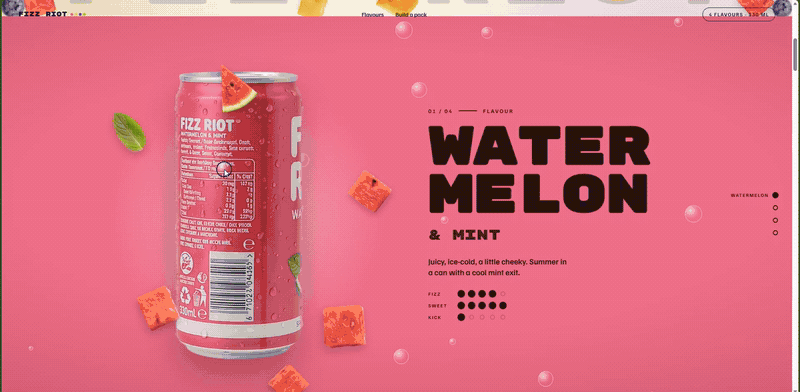

# FIZZ RIOT — Sparkling Soda

Four flavours. Zero chill. FIZZ RIOT is an interactive product story for a fictional sparkling soda brand, built around playful motion, scroll-led flavour storytelling, and a vending-machine playground.

**[Visit the live site](https://fizz-riot.vercel.app/)**



[Watch the full desktop recording](videos/desktop-recording.mp4)

## What you can explore

- **Play in the hero:** drag and throw floating soda cans, or click to pop fizzy particles.
- **Scroll through the flavours:** a long, animated story reveals each can, its flavour notes, and a matching colour world.
- **Build a pack:** choose cans from the vending machine, toss them around, shake the machine, and restock it.
- **Use it on mobile:** the layout and interactions adapt for touch screens and smaller viewports.

## The four flavours

- Watermelon & Mint
- Mango & Chili
- Blueberry & Lavender
- Lime & Ginger

## Run locally

This is a static site with no build step. From the project root, start a local web server:

```bash
python -m http.server 8000
```

Then open [http://localhost:8000](http://localhost:8000). The page loads its animation libraries and fonts from CDNs, so an internet connection is needed.

## Built with

HTML, CSS, and JavaScript, with GSAP and ScrollTrigger for animation, Matter.js for physics, and Lenis for smooth scrolling. The visual assets and animation sequences are in `assets/`; original source material is in `raw/`; utility scripts are in `tools/`.
